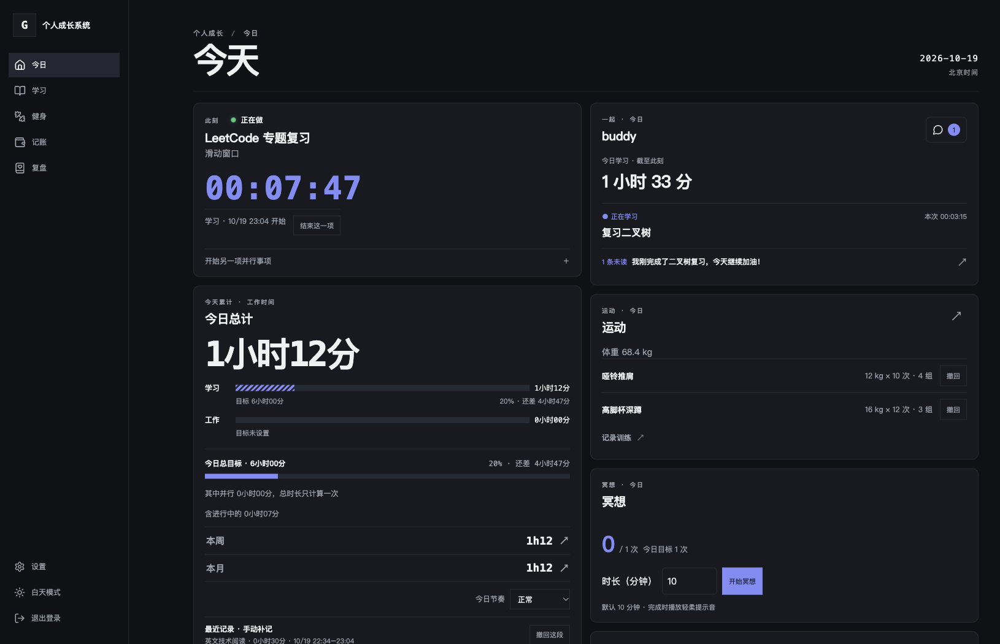
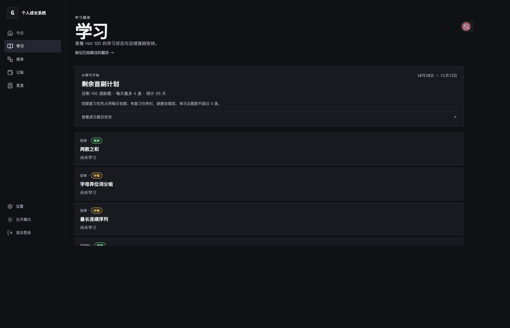

# Growth OS

一个可自托管的个人成长工作台：把专注计时、学习计划、运动、冥想、记账和每日复盘放在同一处，使用 SQLite 保存数据。



截图使用本地虚构演示数据，不含真实账号、服务器地址或个人记录。

## 功能

- **今日总览**：学习与工作计时、手动补记、目标进度、今日任务和最近记录。
- **学习计划**：LeetCode Hot 100 题库、间隔复习、每日新题安排、学习进度预测。
- **运动记录**：按训练动作、重量、次数和组数记录训练，可撤回单组。
- **冥想计时**：设置时长、完成提示音和每日次数目标。
- **记账与统计**：快速记录收支、月度预算、趋势图和 CSV 导出。
- **每日复盘**：记录心情、精力、睡眠、收获和待解决的问题；可选 AI 复盘。
- **一起**：两个指定账号之间分享可选的学习累计和当前事项，并通过同一会话留言与聊天。
- **多账号隔离**：各账号的个人数据独立保存在 SQLite 文件中；只有「一起」会话及共享偏好放在公共数据库。
- **深色与浅色主题**、移动端导航和 PWA 静态资源缓存。



## 技术栈

Next.js 15、React 19、TypeScript、SQLite、Drizzle ORM、Tailwind CSS 4。

## 本地运行

需要 Node.js 22 LTS 和 pnpm 11。

```bash
pnpm install
cp .env.example .env
```

编辑 `.env`，将本地 `DATABASE_PATH` 设为 `./data/growth.db`，生成至少 12 位的本地登录密码哈希：

```bash
pnpm exec tsx scripts/hash-password.ts '替换成自己的本地密码'
```

把命令输出的 Base64 bcrypt 哈希填入 `APP_PASSWORD_HASH`，并为 `SESSION_SECRET` 设置随机且至少 32 字符的值。仅在本地 HTTP 开发时将 `COOKIE_SECURE` 设为 `false`。

```bash
pnpm db:migrate
pnpm seed
pnpm dev
```

打开 `http://localhost:3000`。未设置 `APP_USERS_JSON` 时，登录名为 `admin`，密码是你生成哈希时使用的密码。

## 多账号与「一起」配对

可用 `APP_USERS_JSON` 配置最多 20 个账号。每个 `passwordHash` 都是 Base64 编码的 bcrypt 哈希：

```dotenv
APP_USERS_JSON=[{"username":"alice","passwordHash":"<base64-bcrypt-hash>","role":"admin"},{"username":"bob","passwordHash":"<base64-bcrypt-hash>","role":"user"}]
```

如需使用「一起」，显式配置双方账号名：

```dotenv
TOGETHER_PAIRS_JSON=[["alice","bob"]]
```

双方分别在「设置 → 一起」选择是否分享学习累计和当前事项。默认关闭。对话消息保存于 `data/together.db`；个人学习、运动、复盘和账单留在各自的数据库中。

## AI 复盘（可选）

AI 功能默认关闭。配置 OpenAI 兼容的服务端点、密钥和模型：

```dotenv
AI_BASE_URL=https://example-provider.invalid/v1
AI_API_KEY=<your-server-side-api-key>
AI_MODEL=<model-name>
```

请只在服务器 `.env` 中保存真实 API key，不要把密钥写进代码、截图或提交记录。发送给 AI 的复盘上下文受应用代码控制；使用前请阅读服务商的数据处理政策。

## Docker 自托管

项目附带 Docker Compose 和 Caddy 配置。运行前复制 `.env.example` 为 `.env`、设置登录密码哈希和 `SESSION_SECRET`，并为 SQLite 数据目录准备持久化卷。IP 访问模式需设置 `ACCESS_MODE=ip` 和 `PUBLIC_IP=<host-ip>`；有域名时设置 `ACCESS_MODE=domain` 和 `APP_DOMAIN=<your-domain>`，并将域名解析到自托管主机。

```bash
cp .env.example .env
mkdir -p data/backups data/caddy
docker compose up -d --build
docker compose ps
```

IP 模式使用 Caddy 本地 CA 证书，浏览器会要求信任该证书；域名模式由 Caddy 管理 HTTPS 证书。安全组或防火墙按所选模式放行相应端口。**不要把个人服务器 IP、域名、证书或 `.env` 提交到公开仓库。**

## 数据与备份

- 主账号数据：`data/growth.db`
- 普通账号数据：`data/users/<username>.db`
- 双人会话与共享偏好：`data/together.db`
- 每日自动备份：`data/backups/`，默认保留最近 14 份
- Caddy 证书与状态：`data/caddy/`

备份前建议使用 SQLite 在线备份 API 或暂停应用，确保 WAL 数据完整。恢复前先复制一份当前数据库，再替换目标文件并重启服务。请勿把 `data/` 上传至 GitHub。

## 开发命令

```bash
pnpm dev          # 本地开发
pnpm build        # 生产构建
pnpm start        # 启动生产服务器
pnpm lint         # ESLint
pnpm typecheck    # TypeScript 类型检查
pnpm test         # 单元测试
pnpm test:e2e     # Playwright 端到端测试
pnpm db:migrate   # SQLite 迁移
pnpm seed         # 导入 Hot 100 种子题库
```

端到端验收需要单账号本地环境，并通过 `E2E_PASSWORD` 提供对应明文密码。该测试会写入学习数据，请使用临时数据库运行：

```bash
E2E_PASSWORD='本地测试密码' pnpm test:e2e
```

## 项目结构

```text
src/app/          页面与 API 路由
src/components/   页面组件
src/server/core/  计划、预算、评分和日期等逻辑
src/server/db/    SQLite 数据库、Schema 与迁移
drizzle/          SQL Schema
seed/             LeetCode Hot 100 题目种子数据
tests/            单元与端到端测试
deploy/           Caddy 配置
```

更完整的产品边界和系统设计见 [SPEC.md](SPEC.md)。

## 许可证

[MIT](LICENSE)。Hot 100 题目名称和链接仅作为学习索引；题目正文、题解及商标归各自权利人所有。
